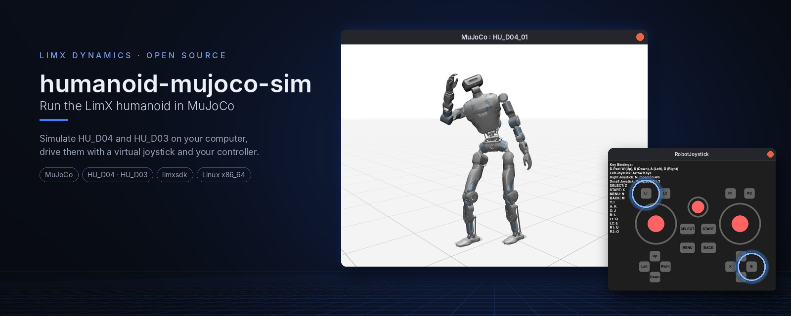
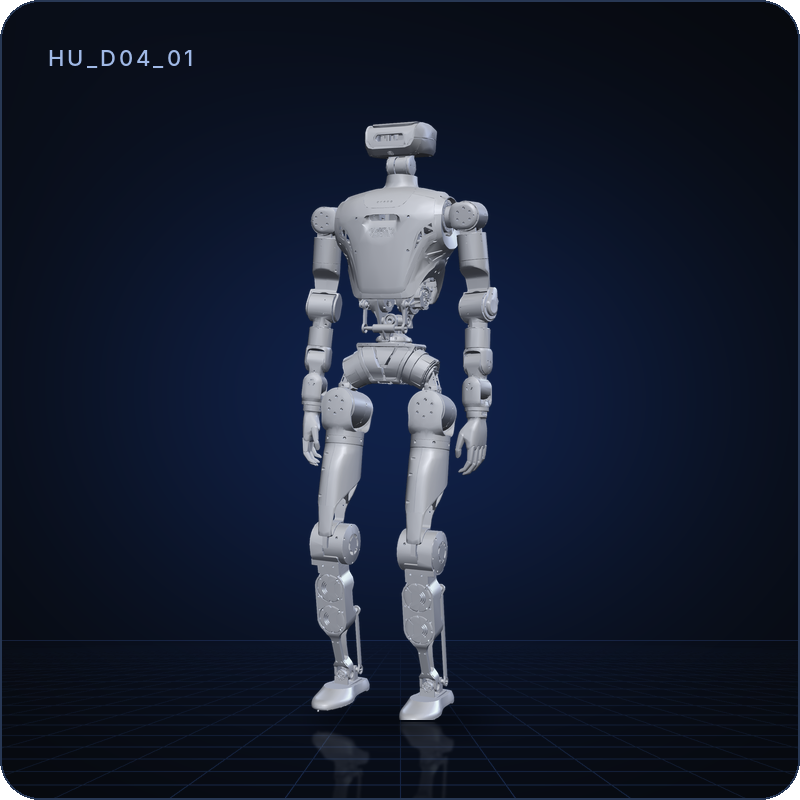
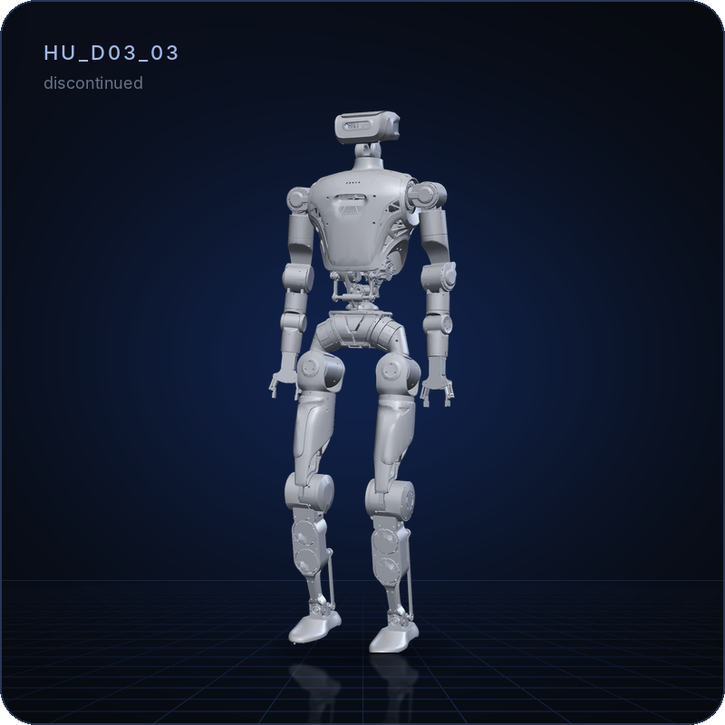
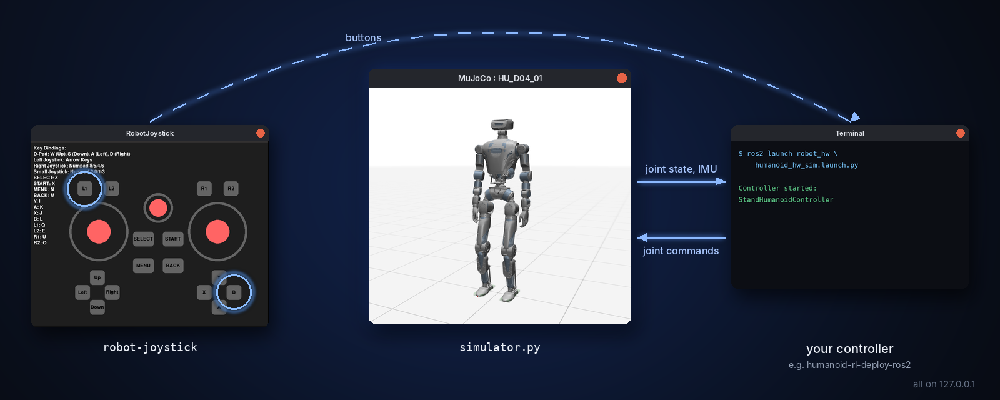
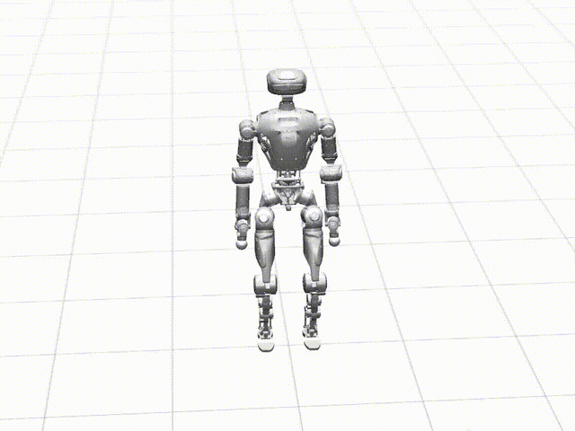

<p align="center">
  
</p>

<p align="center">
  <b>English</b> | <a href="README_cn.md">中文</a>
</p>

<p align="center">
  <a href="LICENSE"></a>
  
  
  
</p>

# humanoid-mujoco-sim

MuJoCo simulation environment for LimX humanoid robots (HU_D03, HU_D04). Use it to visualize robot models, test motion controllers, and validate RL policies in simulation before deploying to hardware.

> **Scope:** the simulator only. It does not contain a controller or policy;
> run one next to it, for example
> [humanoid-rl-deploy-ros2](https://github.com/limxdynamics/humanoid-rl-deploy-ros2).

## Highlights

- **Same interface as the robot.** The simulator talks
  [limxsdk](https://github.com/limxdynamics/limxsdk-lowlevel), so a controller
  written for the robot connects to `127.0.0.1` here and to `10.192.1.2` there.
- **Real ankle and waist linkages.** The bundled `kinematic_projection` maps
  joint commands to the push-rod motors the way the robot does.
- **Virtual joystick included.** `robot-joystick` stands in for the robot's
  remote controller, keyboard-driven.
- **One file to read.** `simulator.py` is about 250 lines: load the model,
  apply PD commands, publish joint state and IMU at the model's 1 kHz step.

## Supported robots

| | Model | Description | Joints | Format |
|:-:|---|---|:-:|---|
|  | `HU_D04_01` | Full-size humanoid | 31 | MJCF ([humanoid-description](https://github.com/limxdynamics/humanoid-description)) |
|  | `HU_D03_03` | Previous generation, discontinued | 31 | MJCF ([humanoid-description](https://github.com/limxdynamics/humanoid-description)) |

## How it works

<p align="center">
  
</p>

## 1. Quick Start

### Prerequisites

- Python 3.8 or higher
- Linux (x86_64)

> The bundled `prebuild/kinematic_projection` helper is x86_64-only. aarch64 users can install the limxsdk wheel but simulation functionality will be limited.

### Install

```bash
# Clone with submodules (HTTPS)
git clone --recurse-submodules https://github.com/limxdynamics/humanoid-mujoco-sim.git
cd humanoid-mujoco-sim

# Install dependencies
pip install -r requirements.txt

# Install the LimX motion control SDK
pip install limxsdk-lowlevel/python3/amd64/limxsdk-*.whl
```

### Set Robot Type

Available models: `HU_D03_03`, `HU_D04_01`

```bash
echo 'export ROBOT_TYPE=HU_D04_01' >> ~/.bashrc && source ~/.bashrc
```

### Run

```bash
python simulator.py
```

A MuJoCo window opens with the robot. With no controller running yet, the robot is not actuated and slumps to the floor; start a controller (see [Connect a controller](#6-connect-a-controller)), then click **Reset** in the left panel. Use mouse (right-click + drag) to rotate the view, scroll to zoom.

## 2. Simulation Controls

| Key | Action |
|-----|--------|
| `Tab` | Toggle left/right UI panels |
| `Space` | Pause / Resume simulation |
| Right-click + drag | Rotate camera |
| Scroll | Zoom |

## 3. Virtual Joystick

Use the included virtual joystick to control the robot interactively:

```bash
# Linux
./robot-joystick/robot-joystick
# Windows
robot-joystick/robot-joystick.exe
```

## 4. Simulation Demonstration



## 5. Related Repositories

- [humanoid-description](https://github.com/limxdynamics/humanoid-description) — Robot model files (URDF/MuJoCo)
- [humanoid-rl-deploy-python](https://github.com/limxdynamics/humanoid-rl-deploy-python) — Python RL policy deployment
- [humanoid-rl-deploy-cpp](https://github.com/limxdynamics/humanoid-rl-deploy-cpp) — ROS-free C++ RL deployment
- [humanoid-rl-isaaclab](https://github.com/limxdynamics/humanoid-rl-isaaclab) — RL training with Isaac Lab

## 6. Connect a controller

Start `simulator.py` first, then your controller with robot address
`127.0.0.1`. With
[humanoid-rl-deploy-ros2](https://github.com/limxdynamics/humanoid-rl-deploy-ros2):

```bash
ros2 launch robot_hw humanoid_hw_sim.launch.py
```

In the virtual joystick, hold `Q` (L1) and press `I` (Y) to stand, or `L` (B)
for the greeting motion; click **Reset** in MuJoCo if the robot has fallen.

Writing your own controller with limxsdk (`Robot(RobotType.Humanoid)`):

- Fill `RobotCmd.motor_names` with `robot.getMotorNames()`. Commands without
  names are rejected by `kinematic_projection` ("joint name: is incorrect")
  and the robot stays limp.
- `simulator.py` steps the model at its own timestep (1 ms) in real time; on a
  slow computer the simulation runs slower than real time.

## License

Apache License 2.0; see [LICENSE](LICENSE) and [NOTICE](NOTICE).
