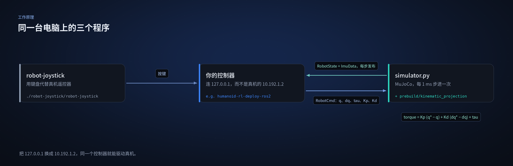

<p align="center">
  
</p>

<p align="center">
  <a href="README.md">English</a> | <b>中文</b>
</p>

<p align="center">
  <a href="LICENSE"></a>
  
  
  
</p>

# humanoid-mujoco-sim

LimX 人形机器人（HU_D03、HU_D04）的 MuJoCo 仿真环境。用于可视化机器人模型、测试运动控制器、在仿真中验证 RL 策略后再部署到真机。

> **范围：** 只包含仿真器，不含控制器或策略；需要在旁边运行一个控制器，例如
> [humanoid-rl-deploy-ros2](https://github.com/limxdynamics/humanoid-rl-deploy-ros2)。

## 亮点

- **与真机相同的接口。** 仿真器通过 [limxsdk](https://github.com/limxdynamics/limxsdk-lowlevel)
  通信，为真机写的控制器在这里连 `127.0.0.1`，在真机上连 `10.192.1.2`。
- **真实的踝部和腰部连杆。** 自带的 `kinematic_projection` 按真机方式把关节指令换算到推杆电机。
- **自带虚拟摇杆。** `robot-joystick` 用键盘模拟机器人遥控器。
- **只需读一个文件。** `simulator.py` 约 250 行：加载模型、执行 PD 指令、按模型 1 kHz 步长发布关节状态和 IMU。

## 支持的机器人

| | 型号 | 说明 | 关节数 | 格式 |
|:-:|---|---|:-:|---|
|  | `HU_D04_01` | 全尺寸人形机器人 | 31 | MJCF（[humanoid-description](https://github.com/limxdynamics/humanoid-description)） |
|  | `HU_D03_03` | 上一代，已停产 | 31 | MJCF（[humanoid-description](https://github.com/limxdynamics/humanoid-description)） |

## 工作原理

<p align="center">
  
</p>

## 1. 快速开始

### 前提条件

- Python 3.8 或更高版本
- Linux (x86_64)

> 内置的 `prebuild/kinematic_projection` 辅助程序仅支持 x86_64。aarch64 用户可安装 limxsdk wheel，但仿真功能将受限。

### 安装

```bash
# 克隆仓库及子模块（HTTPS）
git clone --recurse-submodules https://github.com/limxdynamics/humanoid-mujoco-sim.git
cd humanoid-mujoco-sim

# 安装依赖
pip install -r requirements.txt

# 安装 LimX 运动控制 SDK
pip install limxsdk-lowlevel/python3/amd64/limxsdk-*.whl
```

### 设置机器人型号

可用型号：`HU_D03_03`、`HU_D04_01`

```bash
echo 'export ROBOT_TYPE=HU_D04_01' >> ~/.bashrc && source ~/.bashrc
```

### 运行

```bash
python simulator.py
```

MuJoCo 窗口会打开并显示机器人。此时还没有控制器在运行，机器人没有驱动力，会瘫倒在地；启动控制器（见 [接入控制器](#6-接入控制器)）后，点击左侧面板的 **Reset**。使用鼠标右键拖拽旋转视角，滚轮缩放。

## 2. 仿真操控

| 按键 | 操作 |
|-----|--------|
| `Tab` | 切换左右 UI 面板 |
| `Space` | 暂停 / 恢复仿真 |
| 右键 + 拖拽 | 旋转摄像机 |
| 滚轮 | 缩放 |

## 3. 虚拟摇杆

使用内置的虚拟摇杆交互控制机器人：

```bash
# Linux
./robot-joystick/robot-joystick
# Windows
robot-joystick/robot-joystick.exe
```

## 4. 仿真演示


## 5. 相关仓库

- [humanoid-description](https://github.com/limxdynamics/humanoid-description) — 机器人模型文件（URDF/MuJoCo）
- [humanoid-rl-deploy-python](https://github.com/limxdynamics/humanoid-rl-deploy-python) — Python RL 策略部署
- [humanoid-rl-deploy-cpp](https://github.com/limxdynamics/humanoid-rl-deploy-cpp) — 无 ROS 依赖的 C++ RL 部署
- [humanoid-rl-isaaclab](https://github.com/limxdynamics/humanoid-rl-isaaclab) — 基于 Isaac Lab 的 RL 训练

## 6. 接入控制器

先启动 `simulator.py`，再以机器人地址 `127.0.0.1` 启动你的控制器。以
[humanoid-rl-deploy-ros2](https://github.com/limxdynamics/humanoid-rl-deploy-ros2) 为例：

```bash
ros2 launch robot_hw humanoid_hw_sim.launch.py
```

在虚拟摇杆中按住 `Q`（L1）再按 `I`（Y）站立，或按 `L`（B）执行打招呼动作；机器人摔倒时在 MuJoCo 中点击 **Reset**。

用 limxsdk（`Robot(RobotType.Humanoid)`）自己编写控制器时：

- 把 `RobotCmd.motor_names` 填为 `robot.getMotorNames()`。不带名称的指令会被
  `kinematic_projection` 拒绝（"joint name: is incorrect"），机器人保持无力状态。
- `simulator.py` 按模型自身步长（1 ms）实时步进；电脑较慢时仿真会慢于真实时间。

## 许可证

Apache License 2.0，见 [LICENSE](LICENSE) 和 [NOTICE](NOTICE)。
